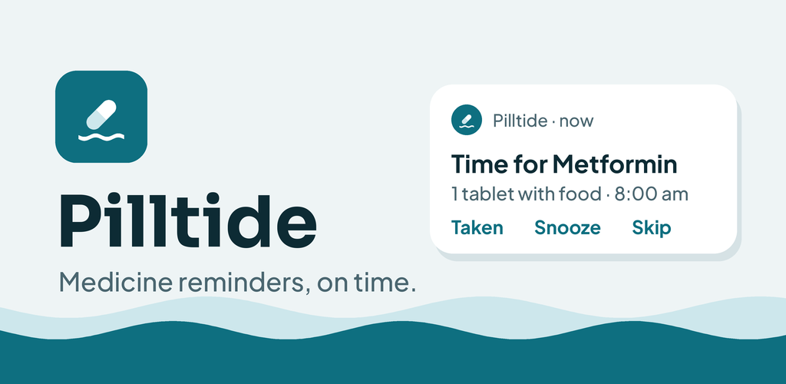
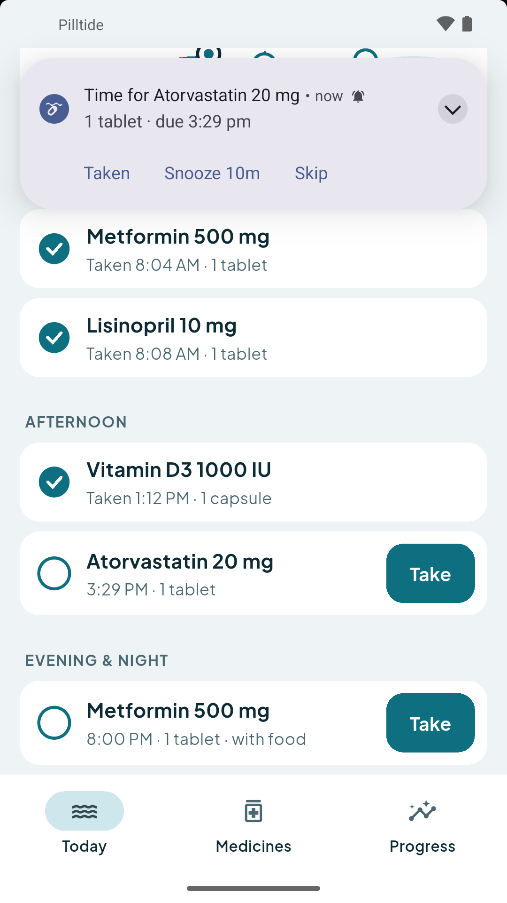
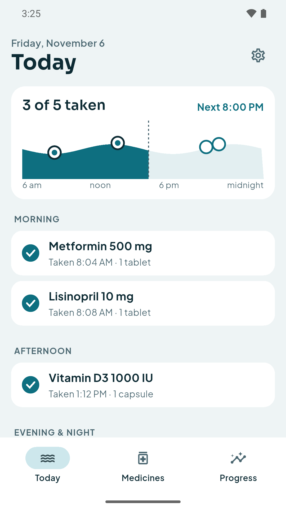
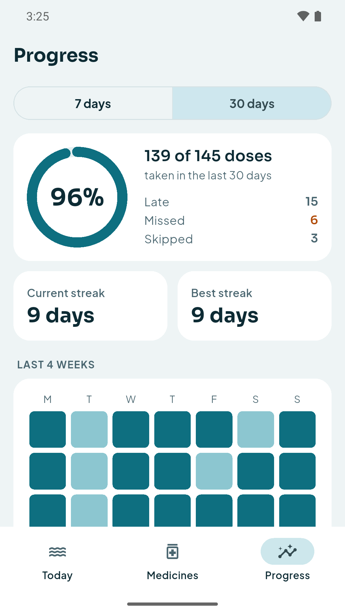

# Pilltide: Medicine Reminder

A free medicine reminder and pill tracker for Android that rings on the exact minute. Mark a dose taken right from the notification, see your streak, and share a 30-day report with your doctor. Works offline, no account.

  
  
  

## What it does

- **Reminders at the exact minute.** Exact alarms that are set again after a restart or a time-zone change. A quick check warns you if battery saving or a missing permission would block them, with a test reminder.
- **Taken, Snooze or Skip from the notification.** No need to open the app. Not answered? It asks again every 10 minutes for up to an hour, and you can turn that off per medicine.
- **Any schedule.** Set times each day, chosen weekdays, every few days, every few hours, on/off cycles like 21 days on and 7 off, or as needed.
- **An honest dose log.** Log the real time you took a dose and the real amount. Late, missed and skipped doses are kept apart.
- **Progress you can show your doctor.** Current and best streak, 7- and 30-day adherence, a 4-week calendar, and a 30-day PDF report to share.
- **Refill alerts.** Count what's left and get warned when it's time to refill.
- **Private.** Your medicine list stays on your phone. No account, no cloud, no analytics.

Pilltide is free and supported by ads. Ads never appear on a reminder, a notification or after you tap Taken.

Pilltide is a reminder and log, not medical advice. It does not check drug interactions or doses.

## Links

- Website: <https://pilltide.pages.dev/>
- Privacy policy: <https://pilltide.pages.dev/privacy/>
- Teaser video: <https://youtube.com/shorts/q3iW-B5XZt8>
- Support: anithabheesetty@gmail.com

---

© 2026 NK Tools. All rights reserved. This repository holds the product page only; the app's source code is not published here.
